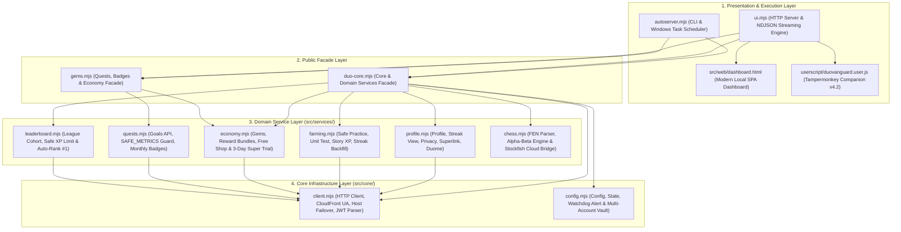

# 🦉 DuoVanguard v4.2 — Autonomous Duolingo Suite

[](https://opensource.org/licenses/MIT)
[](https://nodejs.org/)
[](package.json)
[-purple.svg)](https://github.com/Dzakiudin)

**DuoVanguard** is an enterprise-grade, **zero-dependency self-hosted automation suite** for Duolingo, built on pure Node.js (ESM). It operates completely standalone—no external packages, no Docker containers, and no VPS subscriptions required.

DuoVanguard merges an autonomous **Streak Guardian**, a real-time **Local Web Dashboard (`127.0.0.1:8791`)**, an automated **CLI & Task Scheduler Runner**, and a browser-side **Tampermonkey Companion Userscript v4.2** equipped with a React 18 / Redux Direct Auto-Solver, a Real-Time Chess Bot (vs Oscar & PvP), and client-side Duolingo Max features.

---

## 🌟 Key Highlights & Features

| Capability | Technical Mechanism | Benefit |
|---|---|---|
| **Autonomous Streak Guardian** | Verified session simulation with randomized natural jitter | Preserves streaks daily without tripping CloudFront anti-bot or rate-limit traps |
| **Dual-Engine Auto-Solver** | React 18 Fiber + Redux Direct State Injection (`CHALLENGE_GUESS_CHANGE` / `UPDATE_GRADED_CHALLENGE`) | Solves all 45+ Duolingo challenge types (Stories, Kanji SVG Drawing, Cloze, Tables, etc.) with 100% accuracy |
| **Real-Time Chess Bot** | Hybrid Cloud Stockfish 16 NNUE (`chess-api.com`) + Local Alpha-Beta Pruning (depth 3) | Visual best-move arrow overlays, auto-move execution, and instant-win capability in games vs Oscar / PvP |
| **Multi-Tier XP Farming** | 4 customizable modes: `safe` (+13 XP Practice), `unittest` (~110 XP), `story` (+499 XP), & `smart` fallback | Safe leaderboard progression tailored to your risk tolerance |
| **Quests & Monthly Badges** | Goals API batch engine protected by `SAFE_METRICS` & account-age verification | Completes daily quests without over-sending metrics; claims monthly badges retroactively |
| **Zero External Dependencies** | Written strictly using Node.js standard libraries (`http`, `fs`, `crypto`, `path`) | Instant zero-install deployment with zero supply-chain vulnerabilities |
| **Zero Credential Exposure** | Token-gated dashboard API, encrypted local state vault, stripped JWT output | Credentials are never echoed to console logs, web UI, or git history |

---

## 🏛️ Architectural Blueprint

DuoVanguard adheres to **Clean Layered Architecture**, strict **Separation of Concerns (SoC)**, and the **Facade Pattern**:



### Repository Structure
```text
DuoVanguard/
├── src/
│   ├── core/
│   │   ├── client.mjs              # Resilient HTTP client with CloudFront failover (www -> android-api)
│   │   └── config.mjs              # Configuration, state store, watchdog alerts, and account vault
│   ├── services/
│   │   ├── chess.mjs               # Legal move generator, Alpha-Beta minimax engine, and Stockfish bridge
│   │   ├── economy.mjs             # Gems counter, reward chest claims, and free shop redemption
│   │   ├── farming.mjs             # Practice sessions, unit test runner, story sessions, and streak backfill
│   │   ├── leaderboard.mjs         # League cohort inspector and auto-rank #1 farming engine
│   │   ├── profile.mjs             # Extended profile extractor, course switcher, privacy manager, and watchdog
│   │   └── quests.mjs              # Goals API batch client, SAFE_METRICS validator, and monthly badge claimer
│   └── web/
│       └── dashboard.html          # High-performance responsive single-page application (SPA) dashboard
├── userscript/
│   └── duovanguard.user.js         # Browser companion userscript v4.2 (Auto-Solver + Chess Bot + Max)
├── docs/
│   └── re-findings.md              # Reverse-engineered Duolingo API contracts and telemetry specifications
├── autoserver.mjs                  # Command-line interface and scheduled keeper runner
├── ui.mjs                          # Local HTTP and streaming NDJSON server (http://127.0.0.1:8791)
├── duo-core.mjs                    # Public facade re-exporting core infrastructure and domain services
├── gems.mjs                        # Public facade re-exporting quest, badge, and economy functions
├── duo.config.example.json         # Sanitized configuration template for initial deployment
├── run-streak.bat                  # Windows batch runner for automated streak execution
├── start-dashboard.bat             # Single-click launcher for the local web dashboard
├── install-task.ps1                # Automated Windows Task Scheduler installer (09:00 daily keeper)
├── package.json                    # Project metadata, engine specifications, and npm scripts
├── LICENSE                         # MIT License documentation
└── README.md                       # Complete English technical manual and deployment guide
```

---

## 🚀 Quick Start & Deployment

### 1. Prerequisites
- **Operating System**: Windows 10/11, macOS, or Linux.
- **Runtime**: [Node.js](https://nodejs.org/) version **18.0.0 or higher** (tested on Node v22 LTS).
- **Dependencies**: **None**. Zero external packages required—no `npm install` necessary.

### 2. Initial Configuration (`duo.config.json`)
Copy the provided template to create your live configuration:
```bash
cp duo.config.example.json duo.config.json
```
*(On Windows PowerShell: `Copy-Item .\duo.config.example.json .\duo.config.json`)*

Open `duo.config.json` and insert your Duolingo authentication token (`jwt`):
```json
{
  "jwt": "eyJhbGciOiJIUzI1NiIsInR5cCI6IkpXVCJ9...",
  "timezone": "Asia/Jakarta",
  "course": {
    "from": "id",
    "learning": "ja"
  },
  "lessonMinutes": 3,
  "minGapMs": 90000,
  "maxGapMs": 240000
}
```

> **How to extract your JWT:**
> 1. Log in to [duolingo.com](https://www.duolingo.com) in your web browser.
> 2. Press `F12` to open Developer Tools and navigate to the **Application** (or **Storage**) tab.
> 3. Under **Cookies**, select `https://www.duolingo.com`.
> 4. Copy the value of the cookie named `jwt_token`.

### 3. Account Health & Pre-Flight Verification
Run the built-in diagnostic watchdog to confirm connectivity:
```bash
npm run verify
# Or directly: node autoserver.mjs --verify
```
The watchdog verifies token expiration, network reachability across all Duolingo endpoints (`www`, `android-api`, `goals-api`), active course metadata, and timezone configuration.

---

## 🖥️ Local Web Dashboard (`ui.mjs`)

Launch the dashboard with a single command or by double-clicking `start-dashboard.bat`:
```bash
npm start
# Or directly: node ui.mjs
```
Open **`http://127.0.0.1:8791`** in your web browser.

### Key Dashboard Modules:
1. **⚡ Farming Suite**:
   - **XP Farming**: Safe practice sessions (`GLOBAL_PRACTICE`), fast Unit Tests, Story runs, and intelligent automatic fallback.
   - **Gems Harvesting**: Auto-claim accumulated reward chests with rate-limit protection.
   - **Streak Backfill**: Retroactively fill broken streak dates back to account creation date.
2. **🎯 Quests & Monthly Badges**:
   - **Daily Quests Batch**: Execute quests in safe dry-run or live mode, bounded by `SAFE_METRICS` (maximum 8 metrics per request).
   - **Monthly Badge Explorer**: View and claim monthly challenge badges (`YYYY_MM_monthly`) with account-age safety guards.
3. **🛒 Free Item Shop**:
   - Redeem free shop inventory, such as **15-minute XP Boosts** (`xp_boost_15`, 0 cost), Heart Refills, and the **Free 3-Day Super Duolingo Trial** (`immersive_subscription`).
4. **🏆 League & Leaderboard Dominator**:
   - Track your weekly division standing in real time, view intelligent safe XP limits to evade anti-cheat flags, and farm XP dynamically to secure Rank #1.
5. **♟️ Interactive Chess Bot**:
   - Analyze any board position via FEN using **Stockfish 16 NNUE Cloud** with fallback to the local **Alpha-Beta Engine (depth 3)**, featuring visual move-arrow overlays.
6. **🔧 Account Vault & Tools**:
   - Hot-swap active learning courses, toggle public/private profile visibility, validate Super Family Plan invite links, and manage multiple Duolingo profiles securely.

---

## 🧩 In-Browser Companion Userscript v4.2 (`duovanguard.user.js`)

While the local server (`ui.mjs`) is running, install the userscript via **Tampermonkey** or **Violentmonkey**:
- Navigate to: **`http://127.0.0.1:8791/duovanguard.user.js`**
- Click **Install / Update**, then refresh [duolingo.com](https://www.duolingo.com).

### Browser Hotkeys & In-Lesson Controls:
| Hotkey / Button | Action | Description |
|---|---|---|
| **`Alt + S`** / **SOLVE** | Solve Current Question | Uses the **Dual-Engine Solver** (React 18 Fiber + Redux `CHALLENGE_GUESS_CHANGE` & `UPDATE_GRADED_CHALLENGE`) to grade the active question as correct instantly |
| **`Alt + A`** / **⚡ SOLVE ALL** | Toggle Auto-Solve Loop | Automatically cycles through and solves all remaining questions in the active lesson or story |
| **`Alt + C`** / **♟️ Move!** | Chess Auto-Move | Evaluates the Duolingo chessboard (vs Oscar / PvP), renders best-move arrows, and executes the physical piece move |
| **🏆 Instant Win** | Instant Chess Victory | Directly updates the session state to completed win (`outcome: 'win'`) for chess challenges |
| **✨ Fake Duolingo Max** | Client-Side Max Interceptor | Emulates Duolingo Max / Super subscription flags in the browser interface |

---

## ⌨️ CLI Reference Guide (`autoserver.mjs`)

DuoVanguard is fully scriptable via terminal commands:

```bash
# 1. Daily Streak Keeper (default: runs 1 session only if doneToday is false)
node autoserver.mjs

# 2. Inspect comprehensive account metrics, streak, course, gems, and privacy
node autoserver.mjs --status

# 3. Perform end-to-end health check; writes to duo.alert upon failure
node autoserver.mjs --verify

# 4. Farm N sessions of XP (--xp-mode safe | unittest | story | smart)
node autoserver.mjs --grant 2 --xp-mode safe

# 5. Harvest available gem bundles and chests
node autoserver.mjs --gems

# 6. Inspect shop catalog and claim free 15-minute XP Boost
node autoserver.mjs --shop
node autoserver.mjs --buy xp_boost_15

# 7. Daily Quest batch runner (Default is DRY RUN; append --send for live updates)
node autoserver.mjs --quests
node autoserver.mjs --quests --send

# 8. View Monthly Badges catalog or claim a specific month
node autoserver.mjs --badges
node autoserver.mjs --badges 11/2026 --send

# 9. View weekly league cohort standing or auto-farm to Rank #1
node autoserver.mjs --league
node autoserver.mjs --league --farm

# 10. Check or modify profile privacy status (pub | priv)
node autoserver.mjs --privacy
node autoserver.mjs --privacy pub

# 11. Validate a Super Duolingo Family Plan invitation link
node autoserver.mjs --superlink <invite_code_or_url>
```

---

## ⏰ Automated Scheduling (Windows Task Scheduler)

To configure an automated daily keeper job that runs at **09:00 AM** (executes `--verify` followed by streak retention):

```powershell
powershell -ExecutionPolicy Bypass -File .\install-task.ps1
```

To remove the scheduled job:
```powershell
Unregister-ScheduledTask -TaskName "DuoStreak" -Confirm:$false
```

---

## 🛡️ Operational Safeguards & Security Hygiene

1. **JWT & Credential Isolation**: `duo.config.json` and `duo.config.state.json` are excluded from version control via `.gitignore`. The codebase strictly forbids printing or logging raw JWT credentials.
2. **Quest Batch Guard (`SAFE_METRICS`)**: The goals engine enforces a strict cap of **8 metrics per batch** during `--quests` execution to prevent metric aliasing and unnatural progress spikes on Duolingo's servers.
3. **Human Simulation & Rate-Limit Backoff**: Practice sessions feature configurable jitter delays (`minGapMs` to `maxGapMs`). Encountering HTTP 429 invokes an immediate backoff halt, and HTTP 401 triggers a single safe token refresh before exiting.

---

## 👤 Author & Copyright

- **Author**: Dzakiudin / [jakijekiiii](https://github.com/Dzakiudin)
- **Contact**: dzakiudin07@gmail.com
- **License**: Released under the [MIT License](LICENSE) &copy; 2026 **Dzakiudin (jakijekiiii)**. All rights reserved.
