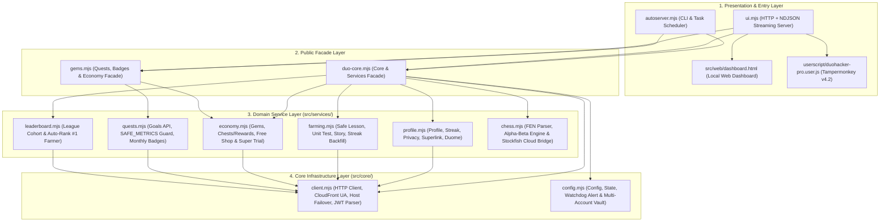

# 🦉 DuoHacker + PRO v4.2 — Self-Hosted Duolingo Suite

Suite otomasi Duolingo **self-hosted** berbasis **Node.js ESM murni (Zero External Dependencies)** tanpa memerlukan Docker, VPS, atau paket `npm` pihak ketiga. Menggabungkan **Streak Keeper otomatis**, **Local Web Dashboard (`127.0.0.1:8791`)**, **CLI Runner**, serta **In-Browser Companion Userscript v4.2** (React 18 + Redux Direct Auto-Solver, Live Chess Bot vs Oscar/PvP, & Fake Duolingo Max).

---

## 🏛️ Prinsip Arsitektur (Clean Layered & Modular Facade Architecture)

Project ini dirancang menggunakan prinsip **Clean Layered Architecture** dengan **Separation of Concerns (SoC)** dan **Facade Pattern**:



### Struktur Direktori
```text
duohacker-pro/
├── src/
│   ├── core/
│   │   ├── client.mjs              # HTTP client + failover (www -> android-api) & parser JWT
│   │   └── config.mjs              # Manajemen config, state, alert watchdog, & multi-akun
│   ├── services/
│   │   ├── chess.mjs               # Mesin catur (Move generator, Alpha-Beta d3, Cloud NNUE bridge)
│   │   ├── economy.mjs             # Gems counter, klaim chest/reward, & katalog Free Item Shop
│   │   ├── farming.mjs             # Sesi lesson, Unit Test, Story XP, & Streak Backfill
│   │   ├── leaderboard.mjs         # Tracker Leaderboard & Auto-League Rank #1
│   │   ├── profile.mjs             # Profil live, streak view, privasi, Superlink, Duome, & Watchdog
│   │   └── quests.mjs              # Daily Quests (SAFE_METRICS guard) & Monthly Badges
│   └── web/
│       └── dashboard.html          # Single-Page Application (SPA) Dashboard UI
├── userscript/
│   └── duohacker-pro.user.js       # Tampermonkey Companion v4.2 (Auto-Solver + Chess Bot + Max)
├── docs/
│   ├── HANDOFF.md                  # Catatan serah-terima & status operasional
│   └── re-findings.md              # Dokumentasi kontrak API & hasil Reverse Engineering
├── autoserver.mjs                  # Entrypoint CLI & Task Scheduler harian
├── ui.mjs                          # Entrypoint Local Web Server (http://127.0.0.1:8791)
├── duo-core.mjs                    # Facade publik modul core & domain services
├── gems.mjs                        # Facade publik modul quests, badges, & economy
├── duo.config.example.json         # Template konfigurasi untuk deployment baru
├── run-streak.bat                  # Wrapper batch untuk Windows Task Scheduler
├── start-dashboard.bat             # Launcher satu-klik untuk membuka Web Dashboard
├── install-task.ps1                # Installer otomatis Windows Scheduled Task ("DuoStreak")
└── package.json                    # Manifest Node.js ESM & daftar script standar
```

---

## 🚀 Panduan Instalasi & Deployment

### 1. Prasyarat
- **OS**: Windows 10 / 11 (atau Linux/macOS untuk CLI & Web Dashboard)
- **Runtime**: [Node.js](https://nodejs.org/) **v18.0.0+** (direkomendasikan **v22 LTS**)
- **Dependency**: **Nol** (tidak perlu menjalankan `npm install`)

### 2. Konfigurasi Akun (`duo.config.json`)
Salin `duo.config.example.json` menjadi `duo.config.json`:
```powershell
Copy-Item .\duo.config.example.json .\duo.config.json
```
Edit `duo.config.json` dan isi `jwt` dari akun Duolingo Anda:
```json
{
  "jwt": "eyJhbGciOiJIUzI1NiIsInR5cCI6IkpXVCJ9...",
  "timezone": "Asia/Jakarta",
  "course": {
    "from": "id",
    "learning": "ja"
  },
  "lessonMinutes": 3,
  "minGapMs": 90000,
  "maxGapMs": 240000
}
```
> **Cara mengambil `jwt`:** Buka `duolingo.com` di browser dan login → Tekan `F12` (DevTools) → Tab **Application** → **Cookies** → `https://www.duolingo.com` → Salin nilai dari cookie **`jwt_token`**.

### 3. Verifikasi Koneksi & Kesehatan Akun
Jalankan watchdog verifikasi sebelum memulai:
```powershell
npm run verify
# atau: node autoserver.mjs --verify
```
Perintah ini memeriksa masa berlaku JWT, konektivitas ke seluruh host Duolingo (`www`, `android-api`, `goals-api`), profil live, serta kecocokan zona waktu.

---

## 🖥️ Menjalankan Self-Hosted Web Dashboard (`ui.mjs`)

Klik dua kali **`start-dashboard.bat`** atau jalankan lewat terminal:
```powershell
npm start
# atau: node ui.mjs
```
Buka **`http://127.0.0.1:8791`** di browser Anda.

### Fitur Utama Web Dashboard:
1. **⚡ Farming (XP, Gems, Streak Backfill)**:
   - **XP Farming**: Mode *Safe Lesson* (`GLOBAL_PRACTICE`), *Unit Test* (cepat), *Story* (`ja-en` / `es-en` / `fr-en`), dan *Smart Auto-Fallback*.
   - **Gems Chest Farming**: Klaim reward bundle berisi Gems secara bertahap dengan jeda aman.
   - **Streak Backfill**: Mengirim sesi mundur tanggal untuk mengisi hari streak yang bolong hingga tanggal pembuatan akun.
2. **🎯 Quests & Monthly Badges**:
   - **Daily Quests Batch**: Mode **Dry Run** (simulasi aman) dan **Send** dengan pembatas `SAFE_METRICS` (maksimal 8 metrik per batch).
   - **Monthly Badges & Quest Explorer**: Klaim lencana bulanan (`YYYY_MM_monthly`) dengan pengaman otomatis terhadap umur akun (`creationTs`).
3. **🛒 Free Item Shop**:
   - Klaim item gratis seperti **`xp_boost_15`** (XP Boost 15 menit, `purchasePrice: 0`), Refill Hearts, dan **Free 3-Day Super Trial** (`immersive_subscription`).
4. **🏆 Leaderboard & Auto-League**:
   - Pantau posisi di liga aktif secara *real-time*, lihat batas aman XP (*Intelligent XP Warning Limit*), dan jalankan **Auto-League** hingga mencapai Peringkat #1.
5. **♟️ Chess Bot & Papan Interaktif**:
   - Analisis posisi FEN menggunakan **Stockfish 16 NNUE Cloud (`chess-api.com`)** dengan fallback otomatis ke mesin **Alpha-Beta Lokal (depth 3)** + panah visual langkah terbaik.
6. **🔧 Tools, Multi-Account Vault, & Duome Stats**:
   - Switcher kursus bahasa aktif, toggle **Profil Publik / Privat**, **Superlink Family Plan Checker**, statistik **Duome**, dan brankas multi-akun tanpa pernah mengekspos JWT ke layar.

---

## 🧩 Memasang Companion Userscript v4.2 di Browser (`duolingo.com`)

Saat server dashboard (`node ui.mjs`) aktif, pasang ekstensi **Tampermonkey** di browser Anda lalu buka URL berikut:
- **`http://127.0.0.1:8791/duohacker-pro.user.js`**

Klik **Install / Update**, lalu buka atau refresh `https://www.duolingo.com`.

### Fitur & Pintasan Keyboard di `duolingo.com`:
| Pintasan / Tombol | Fungsi |
|---|---|
| **`Alt + S`** / Tombol **SOLVE** | Menyelesaikan **1 soal saat ini** secara instan menggunakan **Dual-Engine Solver** (React 18 Fiber + Direct Redux `CHALLENGE_GUESS_CHANGE` & `UPDATE_GRADED_CHALLENGE` + DOM Click/Input) |
| **`Alt + A`** / Tombol **⚡ SOLVE ALL** | Menyalakan / menghentikan **Auto-Solve Loop** hingga seluruh sesi lesson/story selesai |
| **`Alt + C`** / Tombol **♟️ Gerakkan!** | Menganalisis papan catur Duolingo (Vs Oscar / PvP / Puzzle), menggambar panah langkah terbaik di atas papan, dan menggerakkan bidak secara otomatis |
| **🏆 Menang Instan (Oscar / Puzzle)** | Mengirim sinyal penyelesaian menang (`outcome: 'win'`) langsung ke Redux Store untuk challenge catur |
| **✨ Fake Duolingo Max** | Mengaktifkan fitur antarmuka Duolingo Max / Super di sisi klien (*client-side interceptor*) |

---

## ⌨️ Referensi Perintah CLI (`autoserver.mjs`)

Seluruh fitur dapat dijalankan tanpa antarmuka grafis melalui terminal atau skrip terjadwal:

```powershell
# 1. Streak Keeper Harian (default: hanya jalan 1 sesi jika hari ini belum doneToday)
node autoserver.mjs

# 2. Lihat ringkasan status akun, streak, gems, reward, & privasi
node autoserver.mjs --status

# 3. Verifikasi kesehatan akun & tulis duo.alert jika ada masalah
node autoserver.mjs --verify

# 4. XP Farming N sesi (--xp-mode safe | unittest | story | smart)
node autoserver.mjs --grant 2 --xp-mode safe

# 5. Klaim reward bundle berisi Gems
node autoserver.mjs --gems

# 6. Lihat katalog Shop & klaim XP Boost 15 menit gratis
node autoserver.mjs --shop
node autoserver.mjs --buy xp_boost_15

# 7. Daily Quests (Default = DRY RUN; wajib tambah --send untuk kirim nyata)
node autoserver.mjs --quests
node autoserver.mjs --quests --send

# 8. Lihat katalog Monthly Badges atau klaim bulan tertentu
node autoserver.mjs --badges
node autoserver.mjs --badges 11/2026 --send

# 9. Lihat posisi Leaderboard atau jalankan Auto-League ke Rank #1
node autoserver.mjs --league
node autoserver.mjs --league --farm

# 10. Lihat atau ubah privasi profil (pub | priv)
node autoserver.mjs --privacy
node autoserver.mjs --privacy pub

# 11. Cek validitas link undangan Super Family Plan
node autoserver.mjs --superlink <kode_atau_url>
```

---

## ⏰ Penjadwalan Otomatis Harian (Windows Task Scheduler)

Untuk mendaftarkan tugas harian **`DuoStreak`** yang berjalan setiap pukul **09:00 WIB** (diawali `--verify` lalu menjaga streak):

```powershell
powershell -ExecutionPolicy Bypass -File .\install-task.ps1
```
Untuk menghapus tugas terjadwal:
```powershell
Unregister-ScheduledTask -TaskName "DuoStreak" -Confirm:$false
```

---

## 🛡️ Aturan Operasional & Keamanan Akun

1. **Proteksi JWT**: `duo.config.json` dan `duo.config.state.json` telah dimasukkan ke `.gitignore`. Server (`ui.mjs`) dan CLI (`autoserver.mjs`) tidak pernah mencetak string JWT ke konsol, log, maupun respons API.
2. **Batas Aman Daily Quests**: `--quests` selalu berjalan dalam mode **DRY (simulasi)** secara default dan dibatasi maksimal **8 metrik** per batch (`SAFE_METRICS`) agar tidak memicu lonjakan counter metrik aliased di `goals-api`.
3. **Batas Aman Lesson Harian**: Untuk menjaga streak harian secara alami, gunakan mode `safe` dengan jeda acak (*jitter*) dan hindari menjalankan sesi berlebihan dalam waktu singkat.

---

## 👤 Pembuat & Hak Cipta

- **Author**: Dzakiudin / [jakijekiiii](https://github.com/Dzakiudin)
- **Email**: dzakiudin07@gmail.com
- **Lisensi & Hak Cipta**: Dilindungi di bawah [MIT License](LICENSE) &copy; 2026 **Dzakiudin (jakijekiiii)**. Semua hak dilindungi.

